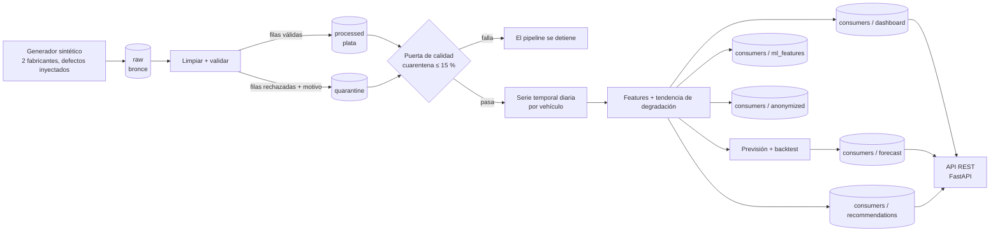
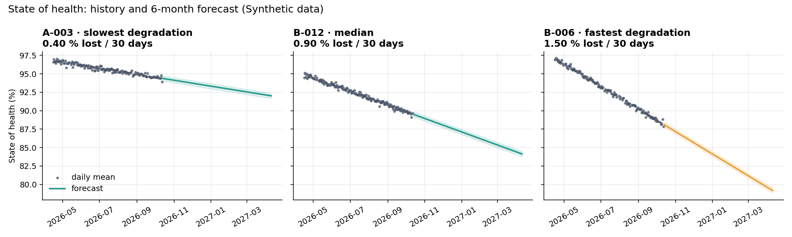
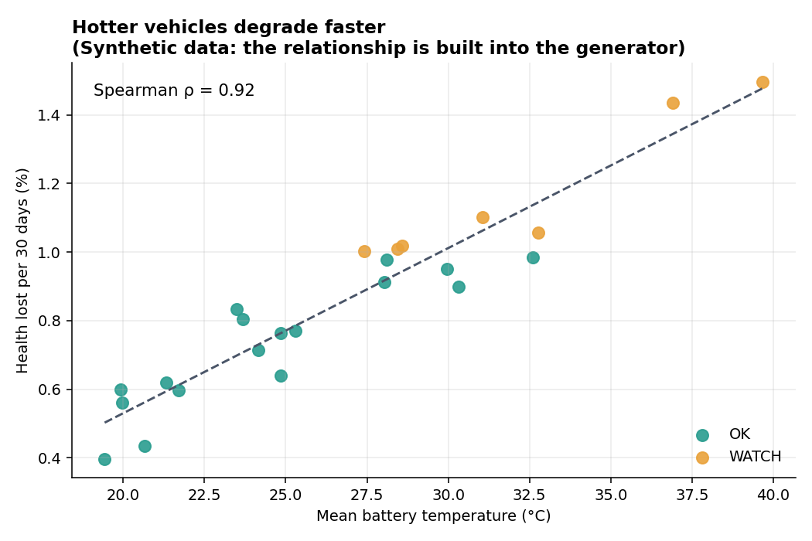

# Pipeline de datos de baterías de vehículos eléctricos

*English: [README.md](README.md)*

Un pipeline de datos pequeño pero completo para **telemetría de baterías de vehículos eléctricos**: entran lecturas
desordenadas de varios fabricantes; salen datos limpios, una **tendencia del estado de salud y una previsión a 6 meses por
vehículo**, un dataset anonimizado y recomendaciones en lenguaje claro. Cada paso está orquestado con **Prefect**,
protegido por una **puerta de calidad**, expuesto mediante una **API REST con FastAPI** y cubierto por **100 tests automáticos**.

> **Los datos son sintéticos.** Un generador simula dos fabricantes y después rompe los datos a propósito de las formas en
> que se rompe la telemetría real. Lo que demuestra este proyecto es el pipeline. Los números de abajo prueban que funciona
> con datos controlados, no que las previsiones valgan para baterías reales (ver [Limitaciones](#limitaciones)).

## Por qué este problema

Cada fabricante envía los datos de la batería a su manera: formatos de fecha distintos, °F frente a °C, IDs de vehículo
inconsistentes, valores imposibles, duplicados. Antes de estimar la salud de una batería u ofrecer un servicio encima,
alguien tiene que convertir eso en una única tabla fiable. Este proyecto es esa capa, de principio a fin.

## Arquitectura



| Capa | Carpeta | Qué contiene |
|---|---|---|
| Bronce | `data/raw/` | CSV crudo por fabricante, sin modificar |
| Plata | `data/processed/` | Una tabla limpia y uniforme (fechas interpretadas, °C, IDs normalizados) |
| Cuarentena | `data/quarantine/` | Cada fila rechazada, **con su motivo** |
| Oro | `data/consumers/` | Resumen para dashboard, features de ML, previsión, recomendaciones y dataset anonimizado |
| Informes | `reports/` | Informe de calidad, resumen de la ejecución y tres gráficos |

## Qué hace cada paso

1. **Generar**: 24 vehículos × 180 días de lecturas de dos fabricantes simulados, con defectos inyectados (duplicados,
   estado de salud mayor que 100 %, un valor centinela `999` de temperatura, estado de salud ausente, fechas futuras e IDs inconsistentes).
2. **Limpiar y validar**: interpretación de fechas según cada fabricante, °F → °C, normalización de IDs, reglas de
   plausibilidad y eliminación de duplicados exactos. **Nada se descarta en silencio:** las filas inválidas van a cuarentena con su motivo.
3. **Puerta de calidad**: si se rechaza más del 15 % de las filas crudas, el pipeline se detiene (los datos malos no mejoran reintentando).
4. **Serie temporal**: las lecturas se agregan a un valor por vehículo y día; los días sin datos quedan visibles como huecos.
5. **Features y tendencia**: una recta sobre el estado de salud de cada vehículo da su ritmo de degradación
   (% de salud perdido cada 30 días); una regla lo convierte en `OK` / `WATCH` / `ATTENTION`.
6. **Previsión + backtest**: la recta se prolonga 180 días y se **prueba sobre tiempo reservado** frente a una referencia ingenua.
7. **Consumidores**: resumen para dashboard, tabla de features de ML, recomendaciones (ES/EN) y un dataset anonimizado con hash con sal.
8. **Gráficos**: previsión por vehículo, temperatura frente a degradación y por qué se rechazaron filas.

## Resultados de una ejecución (semilla 42)

| | |
|---|---|
| Filas crudas | **8.418** (dos ficheros) |
| Filas limpias (plata) | **8.022** |
| Filas en cuarentena | **396** (4,7 %): 160 duplicadas, 87 con salud fuera de rango, 82 sin salud, 42 con temperatura fuera de rango, 25 con fecha futura |
| Vehículos | 24 → 17 `OK`, 7 `WATCH` |
| Backtest de la previsión (último 20 % de cada serie) | error medio **0,155** puntos porcentuales frente a **0,638** de la referencia ingenua "nada cambia"; mejor en 24 / 24 vehículos |
| Efecto de la temperatura (Spearman ρ) | **0,92** |

Cómo leerlos con honestidad:

- El generador **inyectó** 164 duplicados, 82 valores de salud imposibles, 41 centinelas de temperatura, 82 valores ausentes y
  24 fechas futuras. Cada tipo aparece en cuarentena con una cifra cercana a la inyectada; las pequeñas diferencias vienen de
  filas con dos defectos (se cuentan en la primera regla que falla) y de duplicados de filas que ya eran inválidas. El test de
  extremo a extremo exige detectar al menos el 90 % de cada tipo inyectado.
- Las baterías sintéticas se degradan **de forma lineal** y los vehículos más calientes se degradan más rápido **por construcción**.
  Así que es *esperable* que un modelo lineal gane el backtest y que ρ = 0,92, y eso confirma que el pipeline recupera una
  verdad conocida. No dice nada sobre cómo se comportan las baterías reales.





## Inicio rápido

```bash
git clone https://github.com/RenaAbbasova/battery-data-cleaning.git
cd battery-data-cleaning
python -m venv .venv && source .venv/bin/activate        # Windows: .venv\Scripts\activate
pip install -e ".[dev]"

python -m battery_pipeline run                            # ejecuta todo el pipeline
python -m battery_pipeline run --vehicles 40 --days 365   # una flota más grande
python -m battery_pipeline serve                          # API REST en http://127.0.0.1:8000/docs
python -m pytest                                          # 100 tests
python -m battery_pipeline schedule --cron "0 6 * * *"    # cada día a las 06:00 (queda en ejecución)
```

Las salidas aparecen en `data/` y `reports/`. Define `ANON_SALT` con tu propio secreto para el fichero anonimizado
(si no, se usa una sal de demostración y se muestra un aviso).

## API REST

El pipeline produce los datos; un pequeño servicio **FastAPI** los sirve. No calcula nada: lee los ficheros que escribió el
pipeline (y los vuelve a leer cuando una nueva ejecución los sustituye), así que un cliente de la API ve exactamente los
números de los informes.

```bash
python -m battery_pipeline serve        # y abre http://127.0.0.1:8000/docs
```

| Endpoint | Devuelve |
|---|---|
| `GET /health` | ¿Está el servicio activo, ha producido datos el pipeline y son sintéticos? (nunca pide clave) |
| `GET /vehicles?status=WATCH&limit=10` | Vehículos, de mayor a menor degradación, con filtro opcional por estado |
| `GET /vehicles/{id}/health?lang=es` | Estado de salud, ritmo de degradación, previsión a 6 meses y una recomendación (`es` / `en`) |
| `GET /vehicles/{id}/forecast?days=90` | Previsión del estado de salud con su banda, de 1 a 180 días |
| `GET /fleet/summary` | Recuento por estado, vehículo que más y menos se degrada y cómo se evaluó la previsión |
| `GET /quality` | El informe de calidad de datos de la última ejecución |

```bash
curl "http://127.0.0.1:8000/vehicles/B-006/health?lang=es"
```

```json
{
  "vehicle_id": "B-006",
  "status": "WATCH",
  "soh_current": 88.38,
  "degradation_rate_pct_30d": 1.5,
  "soh_in_6_months": 79.17,
  "temp_max": 49.52,
  "days_active": 180,
  "recommendation": "Tu batería está en observación. Cuida las condiciones de carga y temperatura. Ha llegado a 50 °C: evita cargar o aparcar al sol."
}
```

Comportamiento que conviene conocer: un ID mal formado (`A-1`) da **422** y uno desconocido **404**, nunca un error del servidor;
si el pipeline aún no se ha ejecutado, los endpoints de datos responden **503** con el comando que hay que lanzar; los IDs no
distinguen mayúsculas. Si defines `API_KEY`, todos los endpoints excepto `/health` la exigen en la cabecera `X-API-Key`.

## Decisiones de diseño

- **Cuarentena en vez de borrar.** Una fila rechazada es una prueba sobre el sistema de origen; tirarla esconde el problema.
- **Una puerta de calidad que detiene el flujo.** Reintentar sirve para una lectura de fichero que falla, no para datos malos, por eso la puerta no reintenta.
- **Prefect, no un script que llama a otros scripts.** Cada paso es una tarea con estado, logs y reintentos; un fallo detiene todo lo
  que va detrás; el mismo flujo se puede programar sin cambiar código.
- **Un modelo de recta, a propósito.** Se explica en una frase y es una referencia honesta. El backtest lo compara con "nada cambia" en vez de fiarse de él.
- **El backtest divide por tiempo, nunca al azar.** Una división aleatoria filtra el futuro al entrenamiento.
- **Reglas antes que IA en las recomendaciones.** Cada frase se puede rastrear hasta un número y un umbral. La salida
  estructurada (estado + motivos) es justo el contexto que recibiría un LLM si se añade más adelante.
- **Todos los umbrales en `config.py`.** Cualquiera puede ver y cuestionar una regla de negocio sin leer la lógica.
- **Una API que solo lee.** El pipeline es el único sitio donde se calculan los números; la API no puede contradecir los informes.
- **Códigos de error claros.** 422 para una petición mal formada, 404 para un vehículo desconocido, 503 si aún no hay datos: el cliente sabe qué ha pasado.
- **Ficheros CSV.** Portables y fáciles de inspeccionar en una demo; mira la hoja de ruta para ver qué los sustituye a escala.

## Limitaciones

- Solo datos sintéticos. La telemetría real traerá casos que este generador no cubre (huecos de semanas, deriva de sensores, cambios de unidades).
- Las baterías reales no son lineales (hay un "codo" donde la degradación se acelera). El modelo lo subestimaría.
- La banda de la previsión solo refleja la dispersión alrededor de la recta, no la incertidumbre sobre la propia recta: es optimista.
- La anonimización es una seudonimización (hash con sal). **No** garantiza el anonimato; ver `anonymize.py`.
- La API es de solo lectura sobre ficheros CSV y solo tiene una clave compartida opcional. Un uso real necesita autorización por usuario, porque los endpoints devuelven IDs de vehículo.
- La orquestación se ejecuta en local. Desplegarla en un servidor o programador está documentado, no hecho.

## Hoja de ruta

- Servir la API desde una base de datos, con autorización por usuario y límite de peticiones.
- Sustituir el generador por ingesta de telemetría OBD real y un contrato de esquema por fabricante.
- Guardar la serie temporal en una base de datos pensada para ello (p. ej. PostgreSQL + TimescaleDB) en lugar de CSV.
- Modelos de degradación no lineales y por ciclo; compararlos con la recta usando el mismo backtest.
- Comprobaciones de k-anonimato y un gestor de secretos para la sal.
- Capa opcional de LLM sobre las recomendaciones estructuradas, con las reglas como barandilla.

## Estructura del proyecto

```
src/battery_pipeline/
  config.py       umbrales y rutas del data lake
  generate.py     datos crudos sintéticos con defectos inyectados
  clean.py        capa plata: validación y cuarentena
  quality.py      informe y puerta de calidad
  features.py     serie diaria, tendencia de degradación, regla de estado
  forecast.py     previsión y backtest honesto
  recommend.py    recomendaciones basadas en reglas (ES/EN)
  anonymize.py    dataset anonimizado con hash con sal
  api.py          API REST de solo lectura (FastAPI)
  charts.py       los tres gráficos del informe
  flows.py        flujo y tareas de Prefect
  cli.py          python -m battery_pipeline run | schedule | serve
tests/            100 tests (limpieza, series temporales, salidas, API, extremo a extremo)
```

## Tests

`pytest` ejecuta 100 tests: cada regla de limpieza tiene un test que falla si se quita la regla; la tendencia y la previsión se
comprueban contra rectas de pendiente **conocida**; se verifica que el backtest divide por tiempo; y un test de extremo a extremo
ejecuta el flujo real de Prefect, incluido un caso en el que la puerta de calidad debe detener el pipeline.
