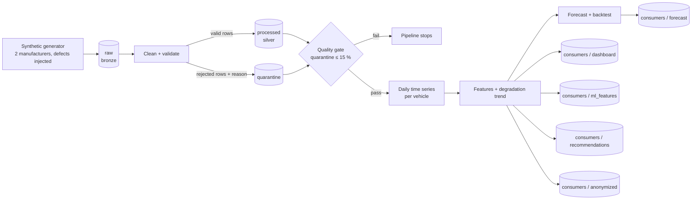

# EV Battery Data Pipeline

*Español: [README.es.md](README.es.md)*

A small, complete data pipeline for **electric-vehicle battery telemetry**: messy multi-manufacturer
readings go in; clean data, a per-vehicle **state-of-health trend and 6-month forecast**, an anonymized
dataset and plain-language recommendations come out. Every step is orchestrated with **Prefect**, guarded by a
**quality gate**, and covered by **77 automated tests**.

> **The data is synthetic.** A generator simulates two manufacturers and then breaks the data on purpose in the
> ways real telemetry breaks. The pipeline is what this project demonstrates. The numbers below prove that it works
> on controlled data, not that the forecasts hold for real batteries (see [Limitations](#limitations)).

## Why this problem

Each manufacturer sends battery data its own way: different timestamp formats, °F vs °C, inconsistent vehicle
IDs, impossible values, duplicates. Before anyone can estimate battery health or offer a service on top, someone has
to turn that into one trustworthy table. This project is that layer, end to end.

## Architecture



| Layer | Folder | What it holds |
|---|---|---|
| Bronze | `data/raw/` | Raw CSV per manufacturer, never modified |
| Silver | `data/processed/` | One clean, uniform table (parsed timestamps, °C, normalized IDs) |
| Quarantine | `data/quarantine/` | Every rejected row, **with the reason** |
| Gold | `data/consumers/` | Dashboard summary, ML features, forecast, recommendations, anonymized dataset |
| Reports | `reports/` | Quality report, run summary and three charts |

## What each step does

1. **Generate** – 24 vehicles × 180 days of readings from two simulated manufacturers, with defects injected
   (duplicates, SoH above 100 %, a `999` temperature sentinel, missing SoH, timestamps in the future, inconsistent IDs).
2. **Clean + validate** – manufacturer-specific timestamp parsing, °F → °C, ID normalization, plausibility rules,
   exact-duplicate removal. **Nothing is silently dropped:** invalid rows go to quarantine with a reason.
3. **Quality gate** – if more than 15 % of raw rows are rejected, the pipeline stops (bad data does not improve by retrying).
4. **Time series** – readings are aggregated to one value per vehicle per day; days without data stay visible as gaps.
5. **Features and trend** – a straight line through each vehicle's state of health gives its degradation rate
   (% of health lost per 30 days); a rule turns it into `OK` / `WATCH` / `ATTENTION`.
6. **Forecast + backtest** – the line is extended 180 days, then **tested on held-out time** against a naive baseline.
7. **Consumers** – dashboard summary, ML feature table, recommendations (ES/EN) and a salted-hash anonymized dataset.
8. **Charts** – forecast per vehicle, temperature vs degradation, and why rows were rejected.

## Results of one run (seed 42)

| | |
|---|---|
| Raw rows | **8,418** (two files) |
| Clean rows (silver) | **8,022** |
| Quarantined rows | **396** (4.7 %): 160 duplicates, 87 SoH out of range, 82 missing SoH, 42 temperature out of range, 25 future timestamps |
| Vehicles | 24 → 17 `OK`, 7 `WATCH` |
| Forecast backtest (last 20 % of each timeline) | mean error **0.155** percentage points vs **0.638** for the naive "nothing changes" baseline; better for 24 / 24 vehicles |
| Temperature effect (Spearman ρ) | **0.92** |

How to read these honestly:

- The generator **injected** 164 duplicates, 82 impossible SoH values, 41 temperature sentinels, 82 missing values and
  24 future timestamps. Each type shows up in quarantine with a count close to what was injected; the small differences come
  from rows that carry two defects (counted under the first rule that fails) and from duplicates of rows that were already
  invalid. The end-to-end test requires at least 90 % of each injected type to be caught.
- The synthetic batteries degrade **linearly** and hotter vehicles degrade faster **by construction**. So a linear model
  winning the backtest and ρ = 0.92 are *expected*, and they confirm that the pipeline recovers a known truth.
  They say nothing about how real batteries behave.


## Quick start

```bash
git clone https://github.com/RenaAbbasova/battery-data-cleaning.git
cd battery-data-cleaning
python -m venv .venv && source .venv/bin/activate        # Windows: .venv\Scripts\activate
pip install -e ".[dev]"

python -m battery_pipeline run                            # run the whole pipeline
python -m battery_pipeline run --vehicles 40 --days 365   # a bigger fleet
python -m pytest                                          # 77 tests
python -m battery_pipeline schedule --cron "0 6 * * *"    # run every day at 06:00 (stays running)
```

Outputs appear in `data/` and `reports/`. Set `ANON_SALT` to your own secret for the anonymized file
(otherwise a demo salt is used and a warning is shown).

## Design decisions

- **Quarantine instead of deleting.** A rejected row is evidence about the source system; throwing it away hides the problem.
- **A quality gate that stops the flow.** Retries make sense for a flaky file read, not for bad data, so the gate has none.
- **Prefect, not a script that calls scripts.** Each step is a task with state, logs and retries; a failure stops everything
  downstream; the same flow can be scheduled without changing code.
- **A straight-line model, on purpose.** It is explainable in one sentence and is an honest baseline. The backtest compares
  it to "nothing changes" instead of trusting it.
- **Time split for the backtest, never random.** A random split leaks the future into training.
- **Rules before AI for the recommendations.** Every sentence traces back to a number and a threshold. The structured output
  (status + reasons) is exactly what an LLM would get as context if one is added later.
- **All thresholds in `config.py`.** Anyone can see and challenge a business rule without reading the logic.
- **CSV files.** Portable and easy to inspect for a demo; see the roadmap for what replaces them at scale.

## Limitations

- Synthetic data only. Real telemetry will bring cases this generator does not (gaps of weeks, sensor drift, unit changes).
- Real batteries are not linear (a "knee" where degradation accelerates). The model would underestimate that.
- The forecast band only reflects scatter around the line, not uncertainty about the line itself: treat it as optimistic.
- The anonymization is a pseudonymization (salted hash). It does **not** guarantee anonymity; see `anonymize.py`.
- Orchestration runs locally. Deploying to a scheduler/server is documented, not done.

## Roadmap

- Replace the generator with real OBD telemetry ingestion and a schema contract per manufacturer.
- Store the time series in a database built for it (e.g. PostgreSQL + TimescaleDB) instead of CSV.
- Non-linear and per-cycle degradation models; compare against the linear baseline using the same backtest.
- k-anonymity checks and a secret manager for the salt.
- Optional LLM layer on top of the structured recommendations, with the rules as guardrails.

## Project structure

```
src/battery_pipeline/
  config.py       thresholds and data-lake paths
  generate.py     synthetic raw data with injected defects
  clean.py        silver layer: validation and quarantine
  quality.py      quality report and gate
  features.py     daily series, degradation trend, status rule
  forecast.py     forecast and honest backtest
  recommend.py    rule-based recommendations (ES/EN)
  anonymize.py    salted-hash anonymized dataset
  charts.py       the three report charts
  flows.py        Prefect flow and tasks
  cli.py          python -m battery_pipeline run | schedule
tests/            77 tests (cleaning, time series, outputs, end-to-end)
```

## Tests

`pytest` runs 77 tests: every cleaning rule has a test that fails if the rule is removed; the trend and forecast are checked
against lines with a **known** slope; the backtest is checked to be a time split; and an end-to-end test runs the real
Prefect flow, including a case where the quality gate must stop the pipeline.
